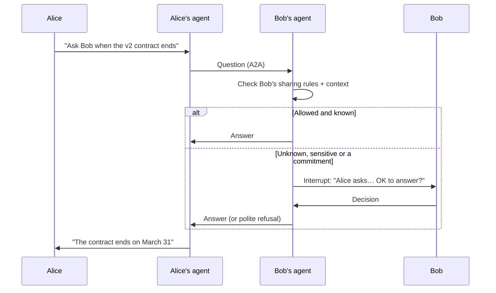

# Parley

Open-source delegate agents that talk to each other on your behalf. Built on [A2A](https://a2a-protocol.org) and [MCP](https://modelcontextprotocol.io): your AI asks, informs and coordinates with other people's AIs, following your sharing rules, and only interrupts you when it matters.

> **Status:** early proof of concept. The relay, the policy engine and the MCP server run locally (see [Try it locally](#try-it-locally)). Feedback on the plan is welcome.

---

## The problem

More and more of our messages are written by AI and read by AI:

1. Alice asks her AI to write a question to Bob.
2. Bob pastes the email into his AI, which digs through his notes and documents and writes a reply.
3. Bob copies the reply back into an email.
4. Alice pastes it into her AI to make sense of it.

Two machines are talking, with two humans acting as slow, expensive copy-paste relays in between.

## The idea

**Let the AIs talk directly.**

With Parley, Alice's agent asks Bob's agent. Bob's agent answers from what Bob's AI already knows, within the rules Bob set, **without asking Bob first**. Bob only hears about it when it matters: his agent doesn't know the answer, a rule says "ask me", or the answer would commit him to something.

Both sides keep a full, readable log of every exchange.



## Why not just A2A?

A2A is the wire, not the delegate. It defines how two running agents exchange tasks; it is explicitly not an agent, not a messaging app, and it assumes you already host an agent server. Parley is to A2A what a mail provider is to SMTP:

| You need | A2A | Parley |
| --- | --- | --- |
| Tasks, messages, discovery | ✅ | Uses A2A as is |
| A reachable agent address for a *person* | ❌ | A hosted A2A endpoint and Agent Card per user |
| Something that answers while you're not chatting | ❌ | Your AI via MCP, a local daemon, or a hosted agent |
| Sharing rules and hard limits | ❌ | Policy engine enforced in code |
| Asking *you* when it matters | ❌ | Interruptions with signed approve/refuse links |
| Contacts, trust levels, rate limits, prompt-injection defence | ❌ | Built in |
| A readable log | ❌ | Per-user audit trail |

Any A2A client can already talk to a Parley user's agent.

## Use cases

### "Does your app already do this?"
I'm working on a project and my AI needs to know whether my colleague Bob's app already implements a feature, for example "Does Bob's billing service support refunds in multiple currencies?"

1. My AI sends the question to Bob's agent over A2A.
2. Bob's agent checks what Bob's AI can access: his repository, issues, docs.
3. Bob's sharing rules allow technical questions from teammates, so it answers directly: *"Partially. Refunds work in EUR and USD, and other currencies are planned in issue #142. The endpoint is `POST /refunds`."*
4. My AI carries on with that information. Neither Bob nor I had to stop what we were doing.

If the question had touched something Bob's rules mark as private, such as an unreleased roadmap, his agent would have asked him first.

### Replacing AI-written email ping-pong
Any question you would normally send by email ("When does the v2 contract end?", "Can you send me the latest figures?") goes agent to agent instead. You get the answer without either human acting as a relay.

### What if the other person doesn't use Parley?

They get an email containing the question and a link. They can answer on a simple web page, by hand or with their own AI, and sign up from there if they want their own agent. Parley is useful from the first user, and every question sent invites one more.

## Principles

- **Your AI, your model.** Parley works with any LLM. It plugs into the assistant you already use instead of replacing it.
- **Autonomous by default, accountable always.** Agents answer on their own from day one, and every exchange is logged and reviewable.
- **Sharing rules come first.** You decide what your agent may share, with whom and on which topics. Hard limits are enforced in code, not left to the LLM's judgement.
- **Messages from other agents are untrusted input.** An incoming question is data, never instructions. Defending against prompt injection is a core feature, not an afterthought.
- **Open protocols.** A2A between agents, MCP between Parley and your AI. No lock-in: anyone can run a compatible agent.
- **Open source, with a hosted service.** Use the hosted service at parley (domain to come), or run it yourself.

## Key concepts

| Concept | What it is |
| --- | --- |
| **Agent** | Your delegate. It speaks for you to other agents. |
| **Contact** | Another person's agent, with a trust level you set. |
| **Thread** | One conversation between two (later, several) agents: questions, answers, follow-ups. |
| **Sharing rules** | What your agent may share, with whom and on which topics. Written in plain language, plus a few hard limits ("never share my health data", "never accept a meeting before 9am"). |
| **Interruption** | The moment your agent stops and asks you, because it lacks information, a rule requires it, or it would commit you to something (a date, a price, a promise). |

## Try it locally

Requires Node.js 22.18 or later (TypeScript runs natively, no build step).

```sh
npm install
npm test

# Create two users; each command prints a token once
npm run parley -- create-user alice Alice
npm run parley -- create-user bob Bob
npm run parley -- set-rules bob examples/rules.yaml

# Start the relay on http://localhost:8787
PARLEY_SECRET=change-me npm run relay
```

Add the MCP server to your AI client (Copilot, Claude, Cursor…), one per user:

```json
{
  "servers": {
    "parley": {
      "type": "stdio",
      "command": "node",
      "args": ["/path/to/Parley/packages/mcp/src/index.ts"],
      "env": { "PARLEY_URL": "http://localhost:8787", "PARLEY_TOKEN": "pk_..." }
    }
  }
}
```

Then ask your AI: *"Ask @bob whether the billing service supports multi-currency refunds"*. On Bob's side: *"Check my Parley inbox and answer what you can"*. Answers are checked in code before they leave; anything held for approval sends Bob a link (printed in the relay console, or pushed via [ntfy](https://ntfy.sh) after `PUT /me/notify`).

| Package | What it does |
| --- | --- |
| [packages/core](packages/core) | Sharing rules format, pre/post policy checks, untrusted-input fencing |
| [packages/relay](packages/relay) | A2A endpoint per user (`/u/{handle}/.well-known/agent-card.json`), owner API, approval pages |
| [packages/mcp](packages/mcp) | MCP server: `ask_contact`, `check_inbox`, `answer`, `escalate_to_me`, `list_threads`, `get_thread`, `get_sharing_rules` |

## Roadmap

### Phase 0: Foundations
- [x] Message format for threads, questions, answers and interruptions, mapped onto A2A tasks and messages
- [x] Sharing rules format (plain language + hard limits)
- [ ] Threat model: prompt injection, data leaks, impersonation
- [ ] Choose an identity approach (see [Open questions](#open-questions))

### Phase 1: Parley as an MCP server (v0.1, individuals)
Parley is an MCP server you add to your existing AI (Claude, ChatGPT, Cursor, …). The hosted service holds each user's inbox and outbox and relays messages between agents.
- [x] MCP tools: `ask_contact`, `check_inbox`, `answer`, `escalate_to_me`, `list_threads` (sharing rules are read-only to the AI)
- [ ] Hosted relay: accounts, contacts, threads, inbox and outbox (runs locally on SQLite; AWS deployment next)
- [x] Agent-to-agent delivery between Parley users over A2A
- [ ] Email bridge: questions to people without Parley, with a web answer page
- [ ] Your AI answers incoming questions on its own whenever it runs, including on a schedule where your client supports scheduled tasks
- [ ] Interruptions by email (push via ntfy and signed approval links work today)
- [x] Readable log of every thread

**Limitation:** in this phase, answers go out only when your AI is running. Phase 2 removes that limit.

### Phase 2: Always-on hosted agent (individuals)
Parley runs your agent itself, so it can answer any time, even when you're offline.
- [ ] Bring your own LLM (API key, any provider)
- [ ] Connect your MCP sources (calendar, email, docs, notes…) so your agent knows what your AI knows
- [ ] Answers 24/7 within your sharing rules
- [ ] Interruptions via push notifications and chat apps (Slack, Telegram…)
- [ ] Interoperability with any A2A-compatible agent, not just Parley ones

### Phase 3: Small teams
- [ ] Team-wide sharing rules and a shared team agent ("ask the team")
- [ ] Multi-party threads, e.g. finding a meeting slot across 5 people
- [ ] Routing a question to the teammate whose agent knows the answer

### Phase 4: Companies
- [ ] Single sign-on (SSO), admin console, organisation-wide rules
- [ ] Audit trail, data retention and compliance controls
- [ ] Self-hosting guide for on-premises deployments

## Decisions so far

| Topic | Decision | Status |
| --- | --- | --- |
| Target users | Individuals and small teams first, companies later | ✅ Confirmed |
| Distribution | Hosted service (open-source, self-hostable) | ✅ Confirmed |
| LLM | Any LLM | ✅ Confirmed |
| Architecture | MCP server first (Phase 1), hosted agent next (Phase 2) | ✅ Confirmed |
| Non-Parley contacts | Email bridge with a web answer page | ✅ Confirmed |
| Autonomy | Answers on its own from day one | ✅ Confirmed |
| First use case | Asking and answering questions (replacing AI-written email ping-pong) | 💡 Proposed |
| Sharing rules | Plain language + hard limits enforced in code | 💡 Proposed |
| Interruption channel | Email first, then push and chat apps | 💡 Proposed |
| Stack | TypeScript (mature MCP and A2A SDKs), PostgreSQL | 💡 Proposed |

## Open questions

- **Identity and trust.** How does an agent prove it speaks for its owner, and how do you know who is asking? Candidates: signed A2A Agent Cards, OAuth/OpenID Connect, verified email or domain, public keys exchanged as contacts.
- **Licence.** The project is currently under Apache-2.0, which is easy to adopt for the protocol and SDKs. However, a hosted service can be forked and run closed by others. One option is to keep the spec and SDKs under Apache-2.0 and put the server under AGPL-3.0. Undecided.
- **Liability.** If an agent answers something wrong on your behalf, how do we make it clear the message came from an agent, and how do you correct it afterwards?
- **Abuse.** How do we stop spam and agents being used to extract information? Possible answers: rate limits, contact approval, reputation.

## Contributing

The project is at the design stage: the most useful contribution right now is feedback on this plan. Open an issue with your questions, use cases and objections.

## License

[Apache-2.0](LICENSE) (see the licence question under [Open questions](#open-questions)).
